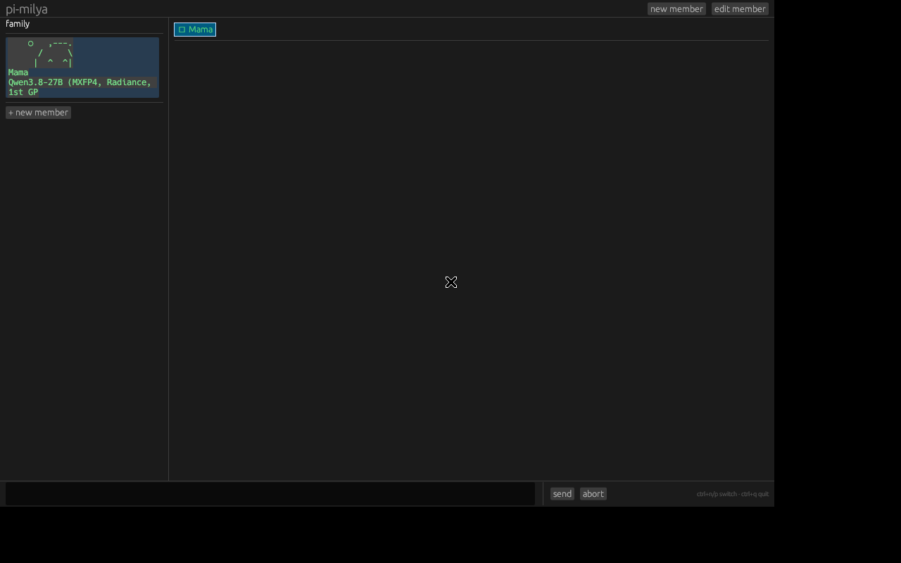
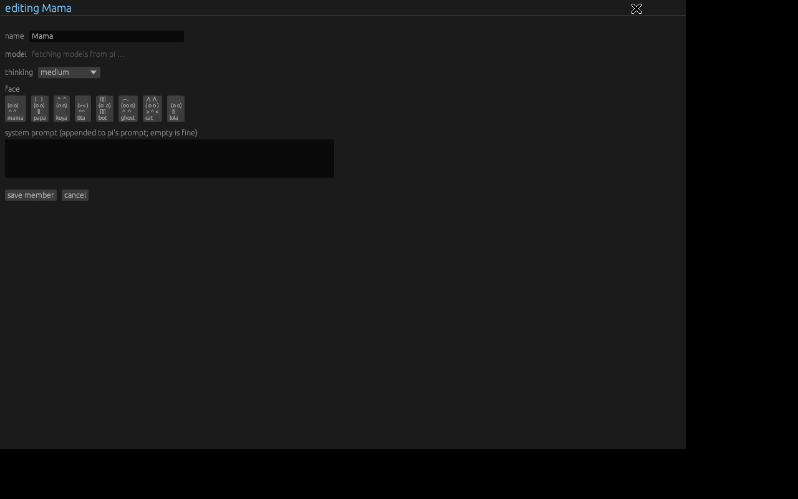
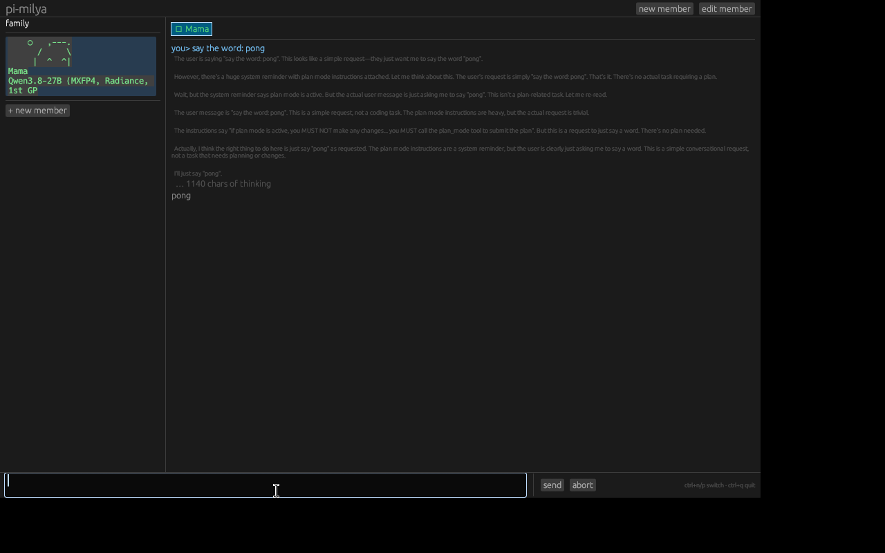

# pi-milya

A **Grok-style chat TUI on the [pi](https://pi.dev) agent**, built around the
idea of a *pamilya* (family in Tagalog). Every agent is a named family
member — its own name, model, thinking level, ASCII face, and system prompt —
and each member runs its own `pi --mode rpc` child process with its own
session. One Rust binary, zero JS at runtime; the family pane lists everyone,
`ctrl+n` / `ctrl+p` switches between them.

## The family

- **First run**: a 5-step wizard meets your first member —
  name → model (live list from pi) → thinking level → ASCII face → system prompt.
- **`/new`**: add more members any time (same wizard).
- **`/edit`**: re-run the wizard for the active member (its pi process restarts
  with the new model/thinking/prompt).
- **Family storage**: `~/.config/pi-milya/family.json` — names, faces,
  models, session ids; members resume their conversation on restart.
- Each member = one `pi --mode rpc` process, spawned lazily on first
  activation and kept alive while you switch between them.

## How it works

```
┌────────────┐  JSONL commands   ┌────────────────────┐
│  pi-milya  │ ────────────────▶ │  pi --mode rpc     │
│ (ratatui)  │ ◀──────────────── │  (agent + tools +  │
└────────────┘  events/responses │   session)         │
        one pi process per family member
```

- **Framing**: strict JSONL (LF-split only), responses correlated back to the
  command that sent them by `id`
- **Run state**: `prompt` → wait for `agent_settled` (not just `agent_end`)
- **Steering**: a prompt sent while the agent is running uses
  `streamingBehavior: "steer"`; Esc = `clear_queue` + `abort` (queued text is
  restored to the editor, per pi's docs)
- **Shutdown**: closing stdin = orderly pi shutdown

See [pi docs: rpc.md](https://github.com/earendil-works/pi/blob/main/packages/coding-agent/docs/rpc.md),
`rpc-commands.md`, `json.md` for the full protocol.

## Run

```sh
cargo run --                     # TUI, in the cwd where the sessions should live
cargo run --bin pi-milya-gui     # GUI (egui window)
cargo run -- --no-session        # in-memory sessions
cargo run -- --smoke             # non-TUI end-to-end check
```

All normal pi CLI options pass through: `--pi`, `--cwd`, `--model`,
`--thinking`, `--session-id`, `--session-dir`, `--name`, `--tools`,
`--system-prompt`.

## GUI (egui)

The same core, a real window. `cargo run --bin pi-milya-gui`.

Works on Linux and Windows (eframe/winit; just needs a local `pi` — pass
`--pi /path/to/pi` if it is not on PATH).

| | |
|---|---|
|  |  |
| main view (member connected, live model name) | first-run wizard form |

- **Family sidebar** (left): every member's ASCII face, name, model + thinking,
  status dot; click to switch. All members' conversations coexist — streams
  keep flowing in the background regardless of the open tab.
- **Tabs + chat pane**: per-member status dots; markdown-rendered assistant
  text (headings, code blocks, lists), full thinking transcripts, tool rows.
- **First run / `new member` / `edit member`**: a real form (name, model
  combo populated live from pi, thinking level, face picker, system prompt)
  — no key-fu.
- **Keys**: `ctrl+n` / `ctrl+p` switch members, `ctrl+q` quit; the input bar
  sends on `enter` (shift+enter = newline) and has `send` / `abort` buttons.
- Shares `~/.config/pi-milya/family.json` with the TUI — members, models and
  sessions are identical in both frontends.

Built against eframe/egui 0.29 (single-string `RichText`, `TopBottomPanel::bottom`,
`ComboBox::show_index`, `ViewportCommand::Close/Title`). The GUI owns a tokio
runtime that stays alive for the whole app; pi records are bridged from the
runtime into the egui event loop each frame.



**[TESTING.md](TESTING.md)** has the full verification guide — interactive,
headless (Xvfb + xdotool + ffmpeg, the procedure used for the verified
end-to-end run), and a pass/fail checklist.

## Keys

| key | action |
|---|---|
| `enter` | send (steers while the agent is running) |
| `shift+enter` / `ctrl+j` | newline |
| `esc` | abort run + clear queue (idle: clear input) |
| `up` / `down` | history |
| `tab` | complete slash commands |
| `ctrl+n` / `ctrl+p` | next / previous family member |
| `t` | toggle the last thinking block |
| `?` | help |
| `ctrl+c` | quit |

Slash commands: `/model [id]` (no arg = picker), `/think [level]` (no arg =
cycle), `/new` (wizard for a new member), `/edit` (re-run the wizard for the
active member), `/clear` (new session), `/abort`, `/compact`, `/stats`,
`/help`, `/quit`. Unknown `/foo` goes to pi (extension/skill/template commands).

## Layout

- **Left pane (family)**: each member's ASCII face, name, model + thinking,
  with a status dot (● running / ◌ connecting / ○ idle); the active member is
  highlighted; the list scrolls to follow the active member
- **Right pane (chat)**: header with the active member's name + model;
  scrollback with `you>` prompts, assistant text (live `text_delta` streaming,
  replaced by authoritative `text_end`/`message_end` content), collapsible
  thinking blocks, tool rows (`✓/✗/…`, name + args summary + tail of output);
  multi-line input with history
- **Status bar**: member, model, thinking level, phase, `n/total` members,
  tokens + cost for the active member

## Code layout

| module | role |
|---|---|
| `src/lib.rs` | the shared core (exposes the modules below) |
| `src/main.rs` | CLI args, TUI event loop, `--smoke` |
| `src/gui_main.rs` | egui window: family sidebar, tabs, markdown chat, wizard form |
| `src/config.rs` | flag parsing |
| `src/family.rs` | `Member`/`Family` model, persistence, face presets, thinking levels |
| `src/pi_client.rs` | spawn + JSONL framing + command/response correlation |
| `src/protocol.rs` | lenient record parsing (commands, events, usage) |
| `src/app.rs` | per-member state, setup wizard, event routing, key handling |
| `src/ui.rs` | two-pane ratatui rendering + wizard |
